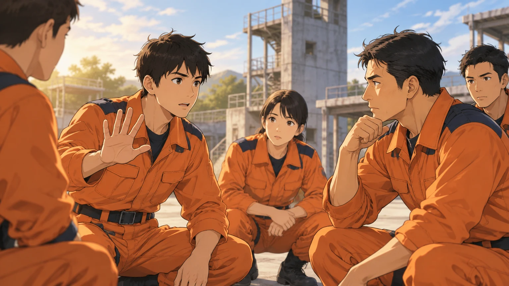
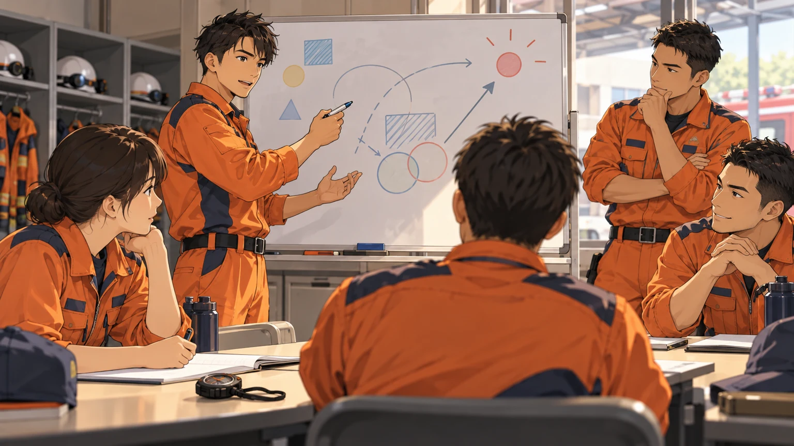

# 救助の「なぜ？」を考える

いつもの行動を、次の訓練の学びに変える。全5回。

文：119LAB.編集部。導入は架空の訓練場面。所属の活動要領・安全管理要領に沿って活用するための学習読み物です。

## 第1回　「確認した」と「確かめた」は同じか

確認する対象・判断基準・異常時の対応を、言葉にしてみる。

### 声は出した。では、何を見たか

「確認よし」。訓練前の準備を終え、隊員が声を出す。隣の先輩が「何を確かめた？」と尋ねると、若手は一瞬、言葉に詰まった。確認したつもりだった。けれど、どこを見て、何を根拠に「よし」としたのかを説明しようとすると、思ったより難しい。これは架空の場面だが、自分の訓練に置き換えて考えてみたい。

### 「よし」の中身をそろえる

確認は、声を出すことや確認表を埋めることだけでは完了しない。確かめたいのは、活動に必要な状態が整っているかどうかだ。同じ「よし」でも、隊員ごとに見ている対象や判断の基準が違えば、認識はそろわない。「よく確認して」と求める前に、何を見てほしいのかを具体的に伝えられているだろうか。

### 対象・基準・対応に分ける

確認の意味を説明するときは、三つに分けてみる。第一は「対象」。何を確かめるのか。第二は「基準」。どのような状態なら適切なのか。第三は「対応」。基準に合わない、あるいは判断できないときに、誰へ伝え、どう扱うのか。器具の状態や使用条件は、所属の要領やメーカーの取扱説明書などで確かめる。そのうえで、判断の根拠を自分の言葉で説明してみたい。

### 慣れた人にも問いがある

経験を重ねた隊員ほど、確認の要点を短い時間で捉えられることがある。しかし、その見方は後輩から見えにくい。「ここを見るのは、この状態を確かめたいから」と理由を添えると、動作の模倣から理解へ進める。教わる側も、分からない基準をそのままにせず、「どこまでならよいのですか」と尋ねてよい。問いが出ることを、確認の質をそろえる機会にしたい。

### 次の訓練で試すこと

普段使っている確認項目を一つ選び、隊員それぞれに対象・基準・対応を説明してもらう。説明が違ったところは、誰が正しいかを急いで決めず、要領などに戻って確かめる。確認項目を増やす前に、今ある一項目の意味をそろえる。「確認した」という報告を、「必要な状態を確かめた」という共通理解につなげたい。

**隊で話し合う、一つの問い：その「よし」は、何を根拠に判断していますか？**

## 第2回　「了解」で、本当に伝わったか

返事と理解の違いから、指示・報告の伝わり方を考える。

### 返事はあったのに

訓練の準備中、指示を受けた隊員が「了解」と答える。ところが、動き始めると指示した側の想定と違っていた。「伝えたはずだ」「そういう意味だと思った」。架空のやり取りだが、どちらも自分は間違っていないと感じている場面は想像しやすい。返事があったことと、同じ内容を理解したことの間には、確かめる余地がある。

### 省略した言葉を見つける

「あれを準備して」「いつもの場所へ」。よく知る相手には通じる言葉も、配属間もない隊員には曖昧かもしれない。対象、場所、順番、完了の条件。話し手の頭の中にある情報が、言葉に含まれているかを見直したい。声が大きくても、必要な情報が欠けていれば解釈は分かれる。伝わらなかった原因を、受け手の注意だけに求めないことが出発点になる。

### 復唱を、認識を確かめる機会に

所属の通信・指示の要領に沿いながら、必要な内容を復唱して確認する。大切なのは、受け手の言葉を発信者も聞き、違いがあれば訂正することだ。言い直しがあったのに聞き流せば、ずれは残る。また、言葉を繰り返せても、具体的な行動を理解しているとは限らない。訓練の打ち合わせでは「最初に何をする予定か」まで説明し合うと、理解の違いを探しやすい。

### 聞き直せる関係をつくる

分からないときの「もう一度お願いします」を、ためらわず言えるだろうか。尋ねた隊員へ「さっき言っただろう」と返すことが続けば、次は質問を控えるかもしれない。指示する側にも、自分の説明が十分ではなかった可能性がある。質問を受けたら内容を具体化し、共通の理解に戻す。確認し直すことを、隊の仕事として扱いたい。

### 次の訓練で試すこと

安全な机上の打ち合わせで、一つの指示を題材に、受け手が想定した行動を説明してみる。話し手は途中で答えを教えず、まず最後まで聞く。対象や順番の違いが見つかったら、どの言葉を補えばよかったかを一緒に考える。「伝え方が悪い」「理解が遅い」で終わらせず、次に使う言葉を一つ決めるところまで進めよう。

**隊で話し合う、一つの問い：同じ指示から、全員が同じ行動を思い描けますか？**

## 第3回　急ぐときほど、何を省かないか

速さを支える準備と、違和感を共有する判断を考える。

### その数秒を、どう考えるか

時間を意識した訓練が始まる直前、若手が「一点、確認させてください」と声を上げた。周囲の視線が集まり、本人は少しためらう。早く始めたい空気の中で、質問することが足を引っ張るように感じられたのかもしれない。架空の場面だが、このとき隊としてどう応じるかを考えてみたい。

### 速さを生む場所を探す

活動を速く進めたいとき、目の前の手順を減らすことだけに目が向いていないだろうか。準備品の置き方、役割の共有、指示の明確さなど、必要な確認を削らずに整えられる部分もある。「どこを省くか」より先に、「どこで迷いや待ち時間が生じているか」を訓練で見直す。速さを個人の焦りに任せず、隊の準備として考えたい。

### 省かない項目を共有する

何を確認し、誰の判断で次へ進むかは、活動内容や所属の要領によって異なる。一律に「必ず何秒止まる」と決めればよいわけではない。訓練前に、安全管理上外せない確認と、その確認を担う人を共有する。変更が生じたときや、判断できない状態になったときの連絡先も確かめる。急いでいる場面で初めて相談する項目を、準備段階で減らしておきたい。

### 違和感を、扱える情報に変える

「何となく変です」という言葉だけでは、受け手も状況をつかみにくい。それでも、最初の声として受け止めたい。そのうえで「どこが」「いつもとどう違うか」を尋ね、事実を整理する。報告する側も、見えたことと自分の推測を分けて伝える。指揮者が状況を確認し判断できるよう、気づきを届く情報へ変えていく。

### 次の訓練で試すこと

訓練を振り返り、時間がかかった場面を一つ選ぶ。必要な確認に使った時間と、情報不足や役割の不明確さで迷った時間を分けて話す。短縮できる準備は何か、維持すべき確認は何かを整理する。訓練中に疑問を報告する方法も、所属の指揮命令系統と安全管理要領に沿って共有する。声を上げた行為だけで評価せず、その情報をどう判断に結びつけたかまで確かめたい。

**隊で話し合う、一つの問い：急いでいるとき、隊で守る確認は何ですか？**

## 第4回　その訓練、何ができれば合格か

所要時間に加えて、判断・連携・確認の過程を見直す。

### 終わった。それで達成か

「前回より早かった」。訓練を終えた隊に、そんな声が上がる。時間の短縮は一つの成果だ。では、今回身につけたかったことは何だったのか。問い直すと「一連の流れを覚える」「役割の連携を見る」など、答えが分かれた。架空の場面だが、同じ訓練に参加していても、見ている目標は違うことがある。

### 目標を、観察できる言葉にする

「連携を高める」だけでは、何を見れば達成を判断できるかが曖昧だ。例えば「役割の変更が必要になったとき、担当者が報告し、隊内で変更を共有できる」とすれば、観察する場面が具体的になる。一度の訓練で全てを確かめようとせず、その日に重点を置く項目を絞る。必要な安全管理を守ったうえで、学ぶ対象をはっきりさせたい。

### 結果と過程を分けて見る

想定を完了できたことと、途中の判断が適切だったことは、分けて振り返りたい。完了していても、指示が届かなかった場面や確認の抜けがあったかもしれない。一方で、途中で立ち止まったからこそ問題を見つけられた場合もある。所要時間だけで優劣を決めず、「何を把握し、何を根拠に選んだか」を本人に尋ねると、外から見えない判断を検討できる。

### 評価する人の見方もそろえる

訓練を見る側も、評価する項目を事前に共有する。「もっとしっかり」「動きが悪い」という感想では、改善する行動が見えにくい。いつ、誰が、何をしたかを記録し、その行動が目標とどう関係するかを整理する。良かった点も同じように具体化する。できなかったことの指摘だけで終えず、次も続けたい行動を残したい。

### 次の訓練で試すこと

開始前に「今日は何ができれば達成か」を一文で書き、隊で共有する。終了後は、その一文に戻って実際の場面を挙げる。達成できなかった場合も、必要だった知識、準備、練習を分けて考え、次回の目標を一つ決める。訓練の回数を増やすだけでなく、一回ごとの学びを次に接続する。その積み重ねを、隊として確かめていきたい。

**隊で話し合う、一つの問い：今日の訓練で、できるようになったことは何ですか？**

## 第5回　経験を、次の隊員の力にする

成功も迷いも言葉にして、判断の理由を次へつなぐ。

### 「経験すれば分かる」の、その先へ

訓練後、若手が先輩に「どうして、あのとき変更したのですか」と尋ねる。「経験かな」と答えかけて、先輩は少し考える。確かに経験はある。けれど、その一言だけでは、若手は同じ場面で何を見ればよいか分からない。架空のやり取りを入口に、最終回は経験の渡し方を考えたい。

### 判断の手がかりを取り出す

経験を伝えるとき、結論だけでなく、その時点で得ていた情報をたどってみる。何が見え、どんな報告を受け、何が分からなかったのか。いくつかの選択肢から、なぜその行動を選んだのか。後から分かった事実と、当時知っていたことを区別すると、判断の背景を説明しやすくなる。「自分なら分かる」を、他の人も検討できる言葉へ変えたい。

### 成功した場面にも問いを向ける

うまくいった訓練も、振り返る材料になる。十分な準備が役立ったのか、早い報告で変更できたのか、それとも偶然、条件に恵まれた部分があったのか。結果が良かったことだけで、全ての行動を正しかったと決めない。次にも再現したい工夫と、次は頼れない条件を分けて考えることが、経験を使える形にする一歩になる。

### 教える側も、聞いて更新する

継承は、先輩が話し、後輩が覚えるだけの時間ではない。若手が迷った場所には、説明の抜けや暗黙の前提が隠れているかもしれない。「どこで判断に困った？」と尋ね、まず本人の言葉を聞く。また、過去の経験は現在の装備や要領と照らして扱う必要がある。経験談をそのまま普遍的な正解にせず、今も通用する理由を確かめながら伝えたい。

### 次の訓練へ、五つの問いを持ち帰る

本連載では、確認の根拠、伝達の理解、急ぐときの判断、訓練の目標を考えてきた。どれも、普段の行動に「なぜ」を添える問いだ。次の振り返りでは「見えた事実」「選んだ行動と理由」「次に試すこと」を短く記録してみる。実際の事例を共有する際は、個人情報や所属の情報管理ルールにも配慮する。立派な教訓にまとめる必要はない。一つの判断を説明できる言葉が、次の隊員の考える手がかりになる。

**隊で話し合う、一つの問い：その経験から、後輩に何を残しますか？**

